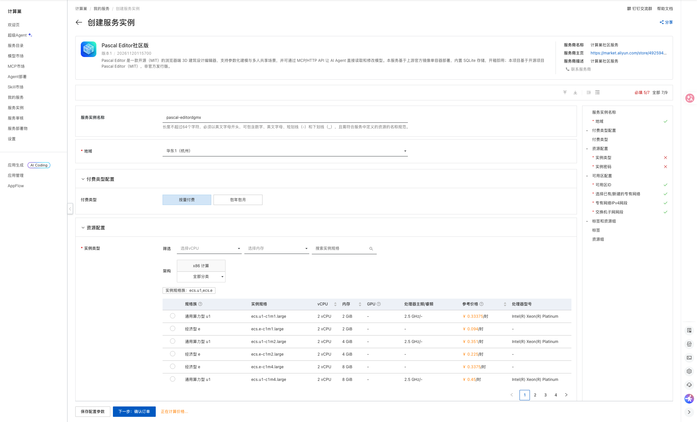
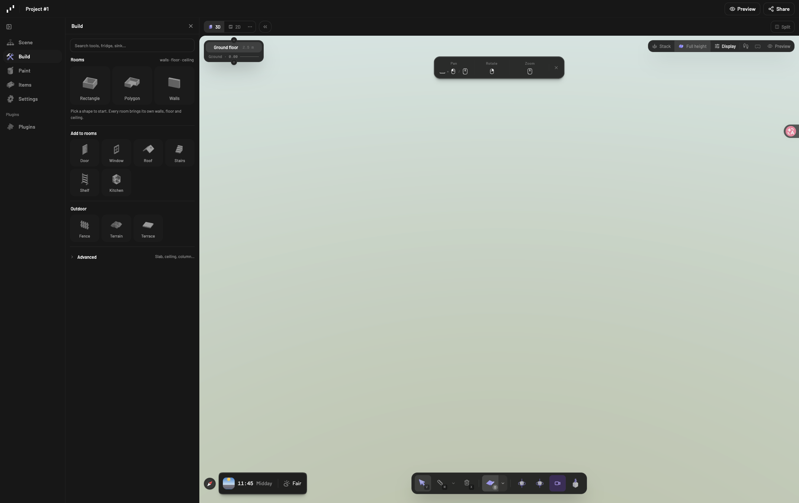

# Deploying Pascal Editor on Alibaba Cloud Compute Nest

## About the service

Pascal Editor is an MIT-licensed, self-hosted 3D building editor that runs entirely in the browser. Walls, slabs, doors, windows and rooms are parametric components: changing one element updates everything hosted on it. A scene is an editable building model rather than a set of drawings. You can model from scratch, import a 3D scan as a reference, import IFC files, and hand the same scene to an AI agent over MCP for reading and editing.

This Compute Nest service deploys a single ECS instance. The image already contains Pascal Editor and its Docker Compose runtime, and all project data stays on the instance.

The editor is served on port 3000 of the instance public IP. Opening the address redirects to a sign-in page that takes the editor access password generated during deployment. The workspace is a single shared space: everyone who signs in sees the same projects.

## Billing

Creating a service from this template is free. Running a service instance incurs:

- ECS instance (minimum 2 vCPU, 4 GiB memory)
- System disk (fixed at 200 GiB ESSD by the template)
- Public bandwidth (fixed at 5 Mbps by the template)

Both pay-as-you-go and subscription are supported; the estimate is shown before you confirm the order.

## Required RAM permissions

If you create the instance with a RAM user, grant the following policies first.

| Policy | Purpose |
| --- | --- |
| AliyunECSFullAccess | Manage ECS instances |
| AliyunVPCFullAccess | Manage VPC resources |
| AliyunROSFullAccess | Manage Resource Orchestration Service stacks |
| AliyunComputeNestUserFullAccess | Manage Compute Nest user-side resources |

## Deployment steps

1. Open the instance creation page, choose a region, and specify the instance type and instance password. You can create a new VPC or use an existing VPC and vSwitch.

   [Deploy now](https://computenest.console.aliyun.com/service/instance/create/cn-hangzhou?type=user&ServiceId=service-01c2fa28facd4d018018)

   

2. Review the price estimate, choose **Next: Confirm Order**, accept the service agreement and click **Create Now**.

3. Wait for the deployment to finish. The **Outputs** section of the instance details page lists `pascal_editor_3000_url`, the editor access password (`AdminPassword`) and the agent API token (`SceneApiToken`).

4. Open the URL from the outputs (`http://<public-ip>:3000`), enter the editor access password, then click **New project** in the workspace to open the editor.

   

## First steps

### Sign-in and workspace

The sign-in page has a single password field — the editor access password from the outputs. After signing in you land in the workspace with the project list and the editor canvas. Nothing needs to be installed on client machines.

### Data persistence

Projects and configuration live under `/opt/pascal-editor` on the instance system disk. Container restarts and rebuilds keep the data; releasing the service instance deletes it, so back up or export models you want to keep.

### Agent API

The template writes the instance public URL into `PASCAL_PUBLIC_URL` and `PASCAL_SCENE_API_ORIGINS`. The `/api/scenes` endpoint only accepts browser origins from that URL and a non-public bearer token. Scripts and agents must send the `SceneApiToken` value as a bearer token and must not embed it in front-end code.

### Changing runtime settings

Edit `/opt/pascal-editor/.env` on the instance, then run `cd /opt/pascal-editor && docker compose up -d`.

## Parameters

| Parameter | Description | Default |
| --- | --- | --- |
| VpcOption | Create a new VPC or reuse an existing one | NewVPC |
| VpcCidrBlock | CIDR block of the new VPC | 192.168.0.0/16 |
| VSwitchCidrBlock | CIDR block of the new vSwitch | 192.168.1.0/24 |
| EcsInstanceType | ECS instance type, at least 2 vCPU / 4 GiB | none |
| InstancePassword | Password for the ECS instance | none |
| PayType | Billing method | PostPaid |
| ZoneId | Availability zone | none |
| VpcId / VSwitchId | Existing VPC and vSwitch (when reusing a VPC) | empty |

## Outputs

| Output | Description |
| --- | --- |
| pascal_editor_3000_url | Editor URL (port 3000) |
| AdminPassword | Editor access password (single sign-in password) |
| SceneApiToken | Bearer token for `/api/scenes` |
| QuickStartGuide | First sign-in and API hints |

## Security notes

- The editor uses a single password. Do not share the access password or the agent API token; if leaked, update `PASCAL_ADMIN_PASSWORD` / `PASCAL_SCENE_API_TOKEN` in `.env` and restart the container.
- Only the instance's own public origin is allowed to call the API from a browser.
- All project data is stored on the system disk under `/opt/pascal-editor` and is removed together with the instance.

## Troubleshooting

**The page stays on the sign-in screen.** Use the editor access password from the instance outputs, not the ECS login password.

**`/api/scenes` returns 401 or 403.** 401 means a missing or wrong bearer token. A 403 mentioning origin means the request origin differs from `PASCAL_PUBLIC_URL`.

**Large 3D scans load slowly.** Scan import is memory hungry; use 4 GiB or more and close other heavy browser tabs.

## Links

- Source code: https://github.com/pascalorg/editor
- License: MIT
