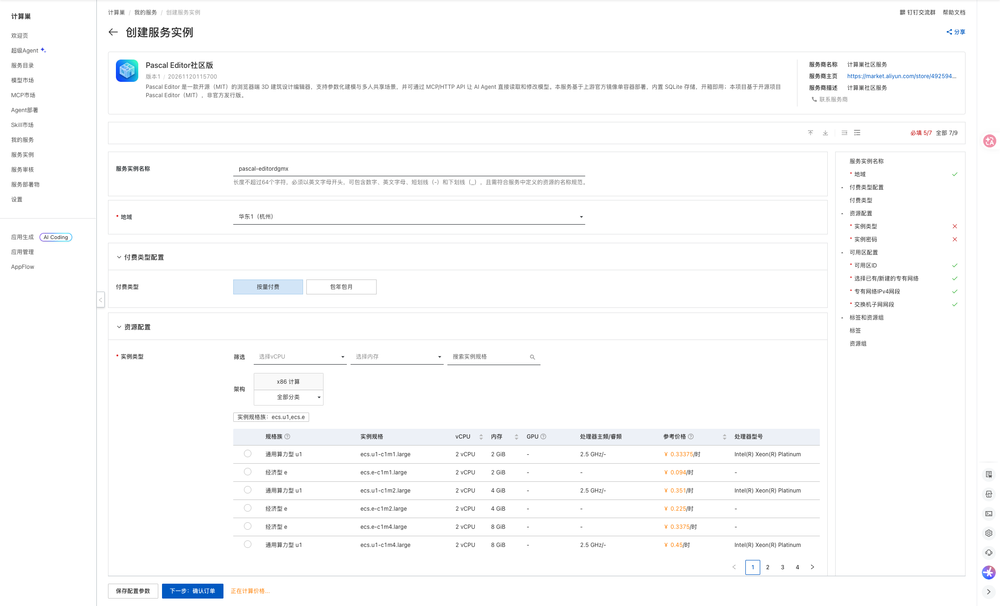
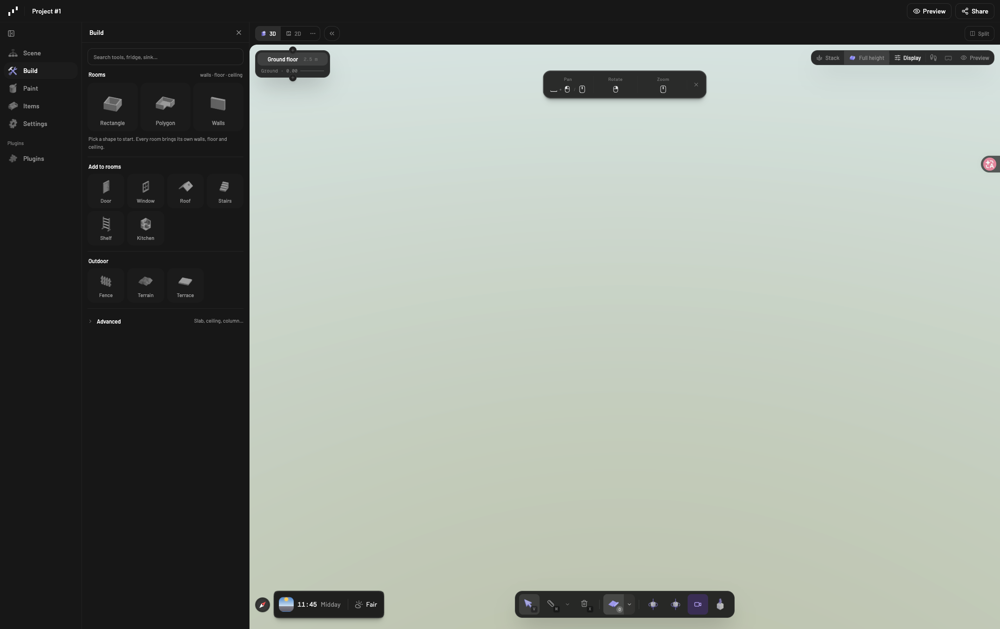

# Pascal Editor 计算巢部署文档

## 服务说明

Pascal Editor 是一款 MIT 许可开源的浏览器端 3D 建筑编辑器，可自托管。墙、楼板、门窗、房间都是参数化构件——改动一处，依附其上的构件自动跟随更新；一个场景就是一个可编辑的建筑模型，而不是一堆散图。支持从零建模、把 3D 扫描得到的点云或模型导入为参考底模、导入 IFC 转换构件，也可以把同一场景通过 MCP 交给 AI Agent 读取和修改。

本计算巢服务采用单机 ECS 部署，ECS 镜像内已预置 Pascal Editor 与 Docker Compose 运行环境，项目数据保存在实例本机，不经过任何第三方服务。

访问入口为实例公网 IP 的 3000 端口：打开后跳转登录页，输入部署时生成（或在输出中查看）的编辑器访问密码即可进入工作区。工作区是单一共享空间，所有登录者看到同一批项目。

## 计费说明

通过此服务模板构建服务不产生费用。用户部署服务实例时，资源费用主要涉及：

- ECS 实例规格（最低 2 vCPU、4 GiB 内存）
- 系统盘容量（模板固定 200 GiB ESSD）
- 公网带宽（模板固定 5 Mbps）

计费方式支持按量付费和包年包月，预估费用会在部署前实时展示。

## RAM账号所需权限

若使用 RAM 用户创建服务实例，需要在创建服务实例前为该 RAM 用户添加相应权限。

| 权限策略名称 | 备注 |
| --- | --- |
| AliyunECSFullAccess | 管理云服务器 ECS 的权限 |
| AliyunVPCFullAccess | 管理专有网络 VPC 的权限 |
| AliyunROSFullAccess | 管理资源编排 ROS 的权限 |
| AliyunComputeNestUserFullAccess | 管理计算巢服务用户侧资源的权限 |

## 服务实例部署流程

### 部署步骤

1. 打开计算巢服务实例创建页面，选择部署地域，填写实例规格、实例密码。网络可选择新建 VPC，也可以选择已有的 VPC 与交换机。

   [部署链接](https://computenest.console.aliyun.com/service/instance/create/cn-hangzhou?type=user&ServiceId=service-01c2fa28facd4d018018)

   

2. 确认询价明细后点击 **下一步：确认订单**，同意服务协议并点击 **立即创建**。

3. 等待服务实例部署完成。部署完成后，在服务实例详情页的 **输出** 区域查看 `pascal_editor_3000_url` 访问地址、`AdminPassword` 编辑器访问密码与 `SceneApiToken` Agent API 令牌。

4. 用浏览器打开输出中的访问地址（`http://<实例公网IP>:3000`），在登录页输入编辑器访问密码，进入工作区后点击 **New project** 即可打开编辑器。

   

## 首次使用说明

### 1. 登录与工作区

登录页只有一个口令入口，即输出中的「编辑器访问密码」。进入后即是工作区，包含项目列表与编辑器画布；浏览器打开的是一整套 Web 应用，团队成员不需要安装桌面端软件。

### 2. 数据持久化

项目数据与配置保存在实例系统盘的 `/opt/pascal-editor` 目录，容器重启或重建不会丢失；释放服务实例时该目录随实例一起删除，请定期备份或导出需要的模型。

### 3. Agent API

模板已把实例公网地址写入 `PASCAL_PUBLIC_URL` 与 `PASCAL_SCENE_API_ORIGINS`，`/api/scenes` 接口仅接受来自本实例公网地址的浏览器 Origin 与非公开的 Bearer 令牌。脚本或 AI Agent 调用时，请使用输出中的「Agent API 令牌」，不要把它写进前端代码。

### 4. 修改运行参数

如需调整运行参数，登录实例编辑 `/opt/pascal-editor/.env`，然后执行 `cd /opt/pascal-editor && docker compose up -d` 生效。

## 参数说明

| 参数 | 说明 | 默认值 |
| --- | --- | --- |
| VpcOption | 网络类型，新建 VPC 或使用已有 VPC | NewVPC |
| VpcCidrBlock | 新建 VPC 的网段 | 192.168.0.0/16 |
| VSwitchCidrBlock | 新建交换机的网段 | 192.168.1.0/24 |
| EcsInstanceType | ECS 实例规格，最低 2 vCPU 4 GiB | 无 |
| InstancePassword | 实例登录密码 | 无 |
| PayType | 付费类型 | PostPaid |
| ZoneId | 可用区 | 无 |
| VpcId / VSwitchId | 已有 VPC 与交换机 ID（选择已有 VPC 时填写） | 空 |

## 输出说明

| 输出 | 说明 |
| --- | --- |
| pascal_editor_3000_url | 编辑器访问地址（端口 3000） |
| AdminPassword | 编辑器访问密码（登录页唯一口令） |
| SceneApiToken | Agent API 令牌，调用 `/api/scenes` 时的 Bearer |
| QuickStartGuide | 首次登录与 API 调用提示 |

## 安全与使用说明

- 编辑器为单口令鉴权，不要将访问密码或 Agent API 令牌公开分享，泄露后请在实例内修改 `.env` 中的 `PASCAL_ADMIN_PASSWORD` / `PASCAL_SCENE_API_TOKEN` 并重启容器。
- 模板只为实例自己的公网地址放行 API Origin，其他域名的浏览器请求会被拒绝。
- 所有项目数据保存在实例系统盘 `/opt/pascal-editor`，释放服务实例会一并删除，请提前备份需要的模型。

## 常见问题

**打开地址后停在登录页？**
确认输入的是服务实例输出中的「编辑器访问密码」，而不是 ECS 的登录密码。

**脚本调用 `/api/scenes` 返回 401 或 403？**
401 表示缺少或错误的 Bearer 令牌；403 且提示 origin 相关时，说明请求的 Origin 不是 `PASCAL_PUBLIC_URL` 对应的地址。

**导入大模型或点云时页面变慢？**
3D 扫描导入对显存和内存占用较高，建议使用 4 GiB 以上内存规格，并在浏览器端关闭其他占用较高的页面。

## 官方链接

- 官方仓库：https://github.com/pascalorg/editor
- 许可证：MIT
